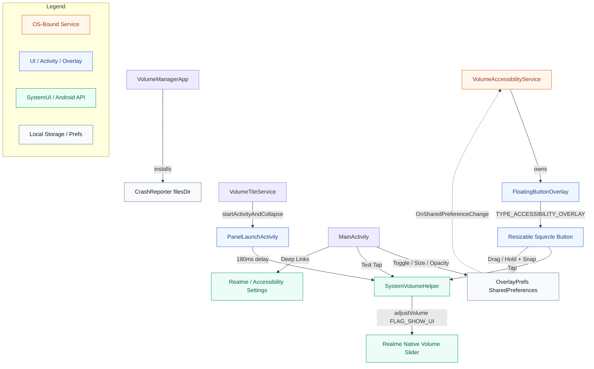
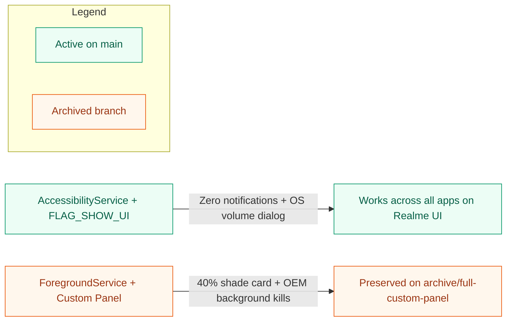

# Architecture (`ARCHITECTURE.md`)
> **1-Line Summary:** How the OS-bound Accessibility overlay, Quick Settings shade-collapse launcher, shared preferences, and Realme setup UI work together.

## 1. Subsystem Map

* **Walkthrough:** Android binds `VolumeAccessibilityService` directly whenever enabled in Accessibility Settings, hosting `FloatingButtonOverlay` with zero notifications. Tapping the squircle calls `SystemVolumeHelper.showSystemVolumeUi()` directly; dragging snaps to the nearest edge and saves dock position to `OverlayPrefs`. `MainActivity` toggles visibility, button size, and idle opacity live via `OverlayPrefs` and links to Realme setup screens. Independently, `VolumeTileService` launches `PanelLaunchActivity` to collapse the Quick Settings shade before invoking `SystemVolumeHelper`.

### [SUBSYSTEM: Accessibility Overlay & Touch Controller] | Aliases: AccessibilityService, TYPE_ACCESSIBILITY_OVERLAY, snapToEdge, touch
> **1-Line Summary:** `VolumeAccessibilityService` binds `FloatingButtonOverlay` with zero notifications, rendering a resizable squircle that triggers `AudioManager.FLAG_SHOW_UI` on tap and snaps to screen edges on drag.
* `VolumeAccessibilityService.onServiceConnected()` marks `isConnected = true`, initializes `FloatingButtonOverlay`, registers a strongly-referenced `OnSharedPreferenceChangeListener` on `OverlayPrefs`, and listens for `ACTION_CONFIGURATION_CHANGED` (`Context.RECEIVER_EXPORTED` on API 33+).
* `accessibility_service_config.xml` sets `android:canRetrieveWindowContent="false"` and requests zero accessibility event types so the service reads no screen content and incurs zero idle event wakeups.
* `FloatingButtonOverlay` creates a `TYPE_ACCESSIBILITY_OVERLAY` window (`FLAG_NOT_FOCUSABLE or FLAG_NOT_TOUCH_MODAL or FLAG_LAYOUT_IN_SCREEN`) sized dynamically to `36`/`48`/`56 dp`, scaled icon (`0.44x`), restored to the saved edge and vertical fraction, and excluded from Android 10+ Back gestures via `systemGestureExclusionRects`.
* Touch state machine: taps (`!hasMoved && !isRepositionMode`) call `SystemVolumeHelper.showSystemVolumeUi()`; drags (`>= scaledTouchSlop`) or holds (`280 ms`) reposition smoothly, snap to the nearest horizontal edge in `180 ms`, and persist dock coordinates to `OverlayPrefs`.
* **Code Anchors:**
  * `app/src/main/java/com/volumemanager/VolumeAccessibilityService.kt :: onServiceConnected`
  * `app/src/main/java/com/volumemanager/VolumeAccessibilityService.kt :: onConfigurationChanged`
  * `app/src/main/java/com/volumemanager/VolumeAccessibilityService.kt :: cleanup`
  * `app/src/main/java/com/volumemanager/overlay/FloatingButtonOverlay.kt :: applyPreferences`
  * `app/src/main/java/com/volumemanager/overlay/FloatingButtonOverlay.kt :: show`
  * `app/src/main/java/com/volumemanager/overlay/FloatingButtonOverlay.kt :: attachHandleTouch`
  * `app/src/main/java/com/volumemanager/overlay/FloatingButtonOverlay.kt :: snapToEdge`
  * `app/src/main/java/com/volumemanager/overlay/FloatingButtonOverlay.kt :: screenSize`
  * `app/src/main/java/com/volumemanager/overlay/FloatingButtonOverlay.kt :: updateGestureExclusion`
  * `app/src/main/res/xml/accessibility_service_config.xml`
  * `app/src/main/res/layout/floating_handle.xml`

### [SUBSYSTEM: Quick Settings Shade-Collapse Launcher] | Aliases: VolumeTileService, PanelLaunchActivity, SystemVolumeHelper, FLAG_SHOW_UI
> **1-Line Summary:** Shared `SystemVolumeHelper` summons Realme's native system volume dialog from both the floating button and the zero-battery Quick Settings `Volume` tile via `PanelLaunchActivity`.
* `SystemVolumeHelper.showSystemVolumeUi()` acquires `AudioManager` and calls `adjustVolume(AudioManager.ADJUST_SAME, AudioManager.FLAG_SHOW_UI)`.
* `VolumeTileService` (`BIND_QUICK_SETTINGS_TILE`) launches translucent, empty-task `PanelLaunchActivity` via `startActivityAndCollapse()` (API 34+ `PendingIntent` overload and legacy `Intent` overload).
* `PanelLaunchActivity` waits `180 ms` for SystemUI's Quick Settings shade to collapse, triggers `SystemVolumeHelper.showSystemVolumeUi()`, and finishes immediately without animation.
* **Code Anchors:**
  * `app/src/main/java/com/volumemanager/util/SystemVolumeHelper.kt :: showSystemVolumeUi`
  * `app/src/main/java/com/volumemanager/VolumeTileService.kt :: onStartListening`
  * `app/src/main/java/com/volumemanager/VolumeTileService.kt :: onClick`
  * `app/src/main/java/com/volumemanager/PanelLaunchActivity.kt :: onCreate`

### [SUBSYSTEM: Preferences & Main Launcher UI] | Aliases: OverlayPrefs, MainActivity, size, opacity, switch, RealmeSettings
> **1-Line Summary:** `MainActivity` provides an instant visibility toggle, size presets (`36`/`48`/`56 dp`), live idle-opacity `SeekBar` (`15%`–`100%`), honest service status, and Realme/Accessibility setup shortcuts.
* `OverlayPrefs` wraps `"volume_manager_prefs"` for `button_enabled`, `size_dp`, `idle_opacity_percent`, `dock_right`, and `dock_y_fraction`.
* `MainActivity` observes `VolumeAccessibilityService.onConnectionChanged`, guards programmatic widget updates with `isUpdatingUi`, and reflects four distinct states (`Active • Running`, `Button Hidden`, `Restart Needed`, `Setup Required`).
* `Permissions` verifies both `AccessibilityManager.getEnabledAccessibilityServiceList()` and `Settings.Secure.ENABLED_ACCESSIBILITY_SERVICES`, and builds a highlighted Accessibility Settings intent (`:settings:fragment_args_key`).
* **Code Anchors:**
  * `app/src/main/java/com/volumemanager/util/OverlayPrefs.kt :: isButtonEnabled`
  * `app/src/main/java/com/volumemanager/util/OverlayPrefs.kt :: saveDockPosition`
  * `app/src/main/java/com/volumemanager/MainActivity.kt :: onCreate`
  * `app/src/main/java/com/volumemanager/MainActivity.kt :: updateStatus`
  * `app/src/main/java/com/volumemanager/util/Permissions.kt :: isAccessibilityServiceEnabled`
  * `app/src/main/java/com/volumemanager/util/Permissions.kt :: accessibilitySettingsIntent`
  * `app/src/main/java/com/volumemanager/util/RealmeSettings.kt :: openAccessibilitySettings`
  * `app/src/main/java/com/volumemanager/util/RealmeSettings.kt :: openAutoLaunch`
  * `app/src/main/java/com/volumemanager/util/RealmeSettings.kt :: openAppBatteryManagement`
  * `app/src/main/res/layout/activity_main.xml`

### [SUBSYSTEM: Offline Diagnostics & Survival Helpers] | Aliases: CrashReporter, VolumeManagerApp, bug report
> **1-Line Summary:** `VolumeManagerApp` installs offline crash/event logging on process start, writing stack traces and rolling diagnostics to `filesDir` with zero network permissions.
* **Code Anchors:**
  * `app/src/main/java/com/volumemanager/VolumeManagerApp.kt :: onCreate`
  * `app/src/main/java/com/volumemanager/util/CrashReporter.kt :: install`
  * `app/src/main/java/com/volumemanager/util/CrashReporter.kt :: buildFullBugReport`

## 2. Design Rationale (Accessibility Overlay vs. Foreground Service)

* **Why AccessibilityService + Native Slider:** Eliminates `SYSTEM_ALERT_WINDOW`, `POST_NOTIFICATIONS`, `FOREGROUND_SERVICE`, `ACCESS_NOTIFICATION_POLICY`, custom `RemoteViews` notifications, and Android's `"displaying over other apps"` banner while delegating actual volume mutation directly to `SystemUI`.

## 3. Extension Recipes
* **Change button preset sizes or idle opacity limits:** update `SIZE_*_DP` or `MIN_IDLE_OPACITY`/`MAX_IDLE_OPACITY` constants in `app/src/main/java/com/volumemanager/util/OverlayPrefs.kt`.
* **Add a Realme UI OEM Settings screen candidate:** append the component name to `app/src/main/java/com/volumemanager/util/RealmeSettings.kt :: openAutoLaunch` or `app/src/main/java/com/volumemanager/util/RealmeSettings.kt :: openAppBatteryManagement`.
