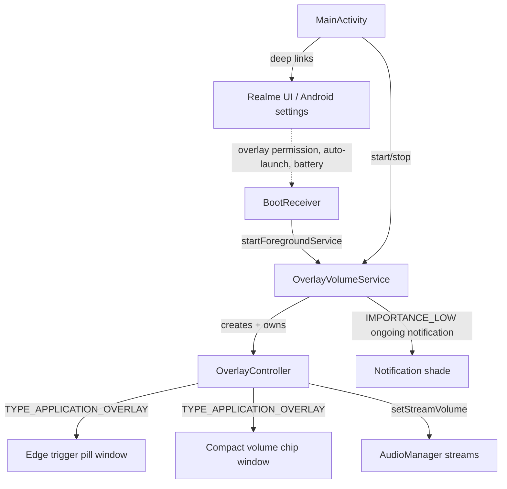
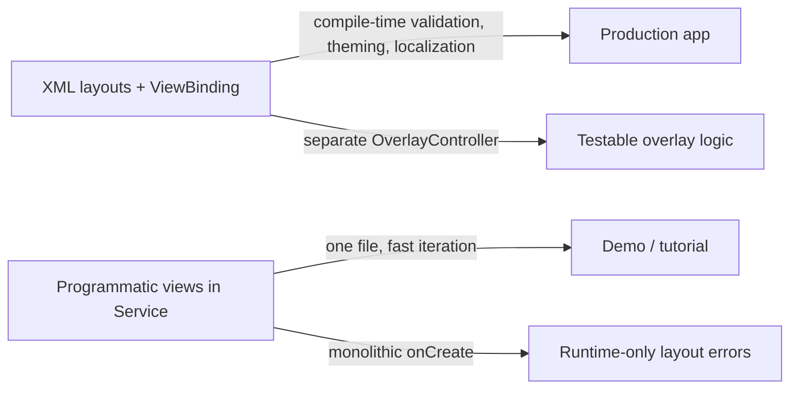

# Architecture (`ARCHITECTURE.md`)
> **1-Line Summary:** How the foreground service, overlay controller and OEM setup launcher fit together, and why the XML/layered approach was chosen over a single programmatic service.

## 1. Subsystem Map

### [SUBSYSTEM: Foreground Service Lifecycle] | Aliases: startForeground, START_STICKY, notification
> **1-Line Summary:** The service is the process anchor: it posts the notification first, then creates the controller, and is recreated by Android after low-memory kills.
* `onCreate()` creates the channel, calls `startForeground(NOTIFICATION_ID, ...)` immediately, then builds `OverlayController` and calls `show()`.
* `onStartCommand()` handles notification toggle actions (`ACTION_TOGGLE_CHIP`, `ACTION_TOGGLE_PANEL`) and returns `START_STICKY`.
* `onDestroy()` calls `controller.destroy()` so no overlay windows leak.
* Anchors: `OverlayVolumeService -> onCreate`, `onStartCommand`, `onDestroy`, `buildNotification`.

### [SUBSYSTEM: Overlay Window Management] | Aliases: WindowManager, edge snap, drag, touch
> **1-Line Summary:** One controller owns both overlay windows and every `addView`/`updateViewLayout`/`removeView` call, keeping the service lifecycle clean.
* Both windows use `TYPE_APPLICATION_OVERLAY` (fallback `TYPE_PHONE` below API 26), `FLAG_NOT_FOCUSABLE or FLAG_NOT_TOUCH_MODAL`, `PixelFormat.TRANSLUCENT`, and `Gravity.TOP or Gravity.START`.
* Edge handle: `ACTION_DOWN` records layout + raw coordinates; `ACTION_MOVE` decides once whether the gesture is horizontal (move the handle) or vertical (change volume); `ACTION_UP` treats sub-slop movement as a tap that toggles the chip, and animates X to the nearest edge after a move.
* The chip is positioned beside the docked edge via `positionChip()` and re-anchored on handle movement, edge snap, and configuration changes.
* Anchors: `OverlayController -> overlayParams`, `attachHandleTouch`, `snapToEdge`, `positionChip`, `configReceiver`.

### [SUBSYSTEM: Volume Mapping] | Aliases: AudioManager, SeekBar, 10 percent steps
> **1-Line Summary:** The chip's `SeekBar` has `max = 10`; each step maps to 10% of the active stream's max volume with rounding and clamping.
* `setPercent()` is the single write path used by both the edge-handle vertical drag and the SeekBar.
* `currentPercent()` guards against `max <= 0`; programmatic SeekBar updates are ignored via `fromUser`.
* The active stream is switched from the compact inline options list, not from four permanent sliders.
* Anchors: `OverlayController -> setPercent`, `currentPercent`, `openChip`.

### [SUBSYSTEM: Boot & OEM Survival] | Aliases: BOOT_COMPLETED, locked boot, auto-launch, battery
> **1-Line Summary:** Boot handling defers locked starts until unlock, and deep-link buttons surface the manual Realme UI settings the OS needs.
* `BOOT_COMPLETED` / `QUICKBOOT_POWERON` / `MY_PACKAGE_REPLACED` start directly; `LOCKED_BOOT_COMPLETED` registers a one-shot `ACTION_USER_UNLOCKED` receiver in device-protected storage.
* Dynamic receivers specify `Context.RECEIVER_EXPORTED` on API 33+ as required.
* `RealmeSettings` tries multiple ColorOS/Realme component names and falls back to App Details.
* Anchors: `BootReceiver -> onReceive`, `waitForUnlock`, `startSafely`; `RealmeSettings -> openAutoLaunch`, `openAppBatteryManagement`.

## 2. Design Rationale (XML + layers vs. single programmatic service)

* **Why XML:** aapt validates layouts at build time; dp dimensions, colours and strings live in resource files; the panel is easier to restyle without touching logic.
* **Why layers:** the service owns only lifecycle and notification duties, so the ~300-line touch/window code stays in `OverlayController` and the OEM deep-links stay in `RealmeSettings`.
* **Trade-off accepted:** more files and a ViewBinding class, but no raw pixel constants, no hardcoded English strings, and no build-breaking legacy manifest `package` attribute.

## 3. Extension Recipes

* **Change drag granularity:** edit `volumeStepPx` in `OverlayController` (14 dp default); decrease for finer drag travel, increase for coarser.
* **Change volume intervals:** edit `SeekBar.max` in `volume_chip.xml` and multiply `progress` accordingly in `OverlayController -> openChip` / `setPercent` (e.g., max 20 gives 5% steps).
* **Add a fifth stream:** add an option id in `volume_chip.xml`, append it to `optionIds`, its `AudioManager.STREAM_*` to `streams`, and its label to `labels` in `OverlayController`; no service changes needed.
* **Add a Realme model:** append a candidate component to the matching list in `RealmeSettings -> openAutoLaunch` / `openAppBatteryManagement`.
