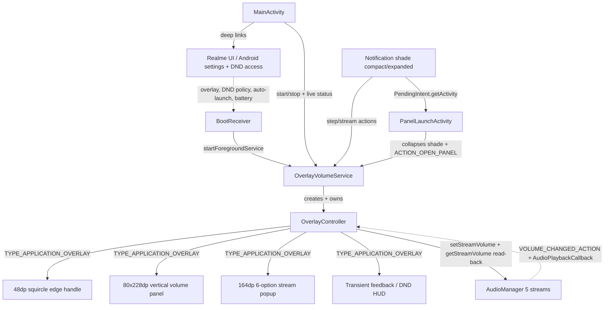
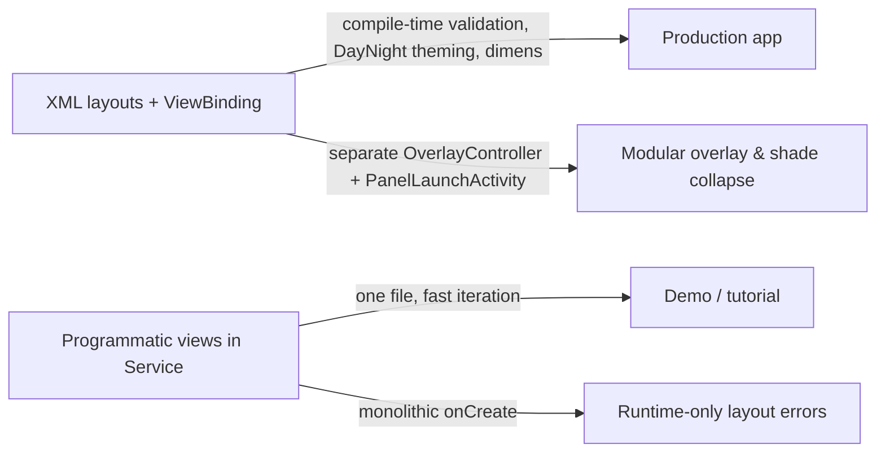

# Architecture (`ARCHITECTURE.md`)
> **1-Line Summary:** How the foreground service, transparent panel launcher, overlay controller, smart stream detector, and OEM setup launcher fit together.

## 1. Subsystem Map

### [SUBSYSTEM: Foreground Service & Shade-Collapse Launcher] | Aliases: startForeground, START_STICKY, notification, PanelLaunchActivity
> **1-Line Summary:** The service anchors the process, pre-validates dual compact/expanded `DecoratedCustomViewStyle` notifications with stock fallback, and pairs with `PanelLaunchActivity` to collapse the shade before displaying overlays.
* `onCreate()` sets `isRunning = true`, notifies `onRunningStateChanged`, creates the channel, sets `permissionMissing = !Permissions.canDrawOverlays(this)`, calls `startForeground(NOTIFICATION_ID, safeBuildNotification())` immediately, builds `OverlayController`, calls `show()`, and calls `syncCurrentState()` when overlay permission is granted.
* `onStartCommand()` catches unexpected `Throwable`s via `CrashReporter.recordError()` and dispatches `ACTION_OPEN_PANEL` (180 ms delayed after shade collapse), `ACTION_TOGGLE_PANEL`, `ACTION_CYCLE_STREAM`, `ACTION_SELECT_STREAM`, `ACTION_AUTO_STREAM`, `ACTION_VOLUME_UP`, `ACTION_VOLUME_DOWN`, and `ACTION_STOP`.
* `safeBuildNotification()` runs `buildCustomNotification()`, validates both `RemoteViews` layouts via `validateRemoteViews()` (`RemoteViews.apply(...)` into an in-memory `FrameLayout`), and falls back automatically to `buildStockFallbackNotification()` if any inflation error occurs.
* `PanelLaunchActivity` is an empty-task translucent `android.app.Activity` that causes SystemUI to collapse the notification shade natively on launch, forwards `ACTION_OPEN_PANEL` to `OverlayVolumeService`, and finishes immediately with animations suppressed.
* `onDestroy()` clears `isRunning = false` and `usingStockNotificationFallback = false`, notifies listeners, cancels callbacks, and calls `controller.destroy()`.
* Anchors: `OverlayVolumeService -> onCreate`, `onStartCommand`, `onDestroy`, `safeBuildNotification`, `buildCustomNotification`, `validateRemoteViews`, `buildStockFallbackNotification`, `panelActivityPendingIntent`; `PanelLaunchActivity -> onCreate`.

### [SUBSYSTEM: Overlay Window Management] | Aliases: WindowManager, edge snap, drag, touch, squircle, vertical panel
> **1-Line Summary:** One controller owns all overlay windows (48dp squircle handle, 80×228dp vertical panel, 164dp 6-option popup, HUD) and every `addView`/`updateViewLayout`/`removeView` call safely.
* All overlay windows use `TYPE_APPLICATION_OVERLAY` (fallback `TYPE_PHONE` below API 26), `FLAG_NOT_FOCUSABLE or FLAG_NOT_TOUCH_MODAL or FLAG_LAYOUT_IN_SCREEN`, `PixelFormat.TRANSLUCENT`, and `Gravity.TOP or Gravity.START`.
* Panel and popup windows add `FLAG_WATCH_OUTSIDE_TOUCH` so tapping outside dismisses the popup first, then the panel.
* **Multi-Window & PiP Resilience:** `FLAG_LAYOUT_IN_SCREEN` keeps coordinates physical-screen-relative during split-screen/PiP, and `screenSize()` resolves bounds from `DisplayMetrics` first to avoid Android 11 Service `currentWindowMetrics` exceptions.
* **Tactile Squircle Handle:** `48×48 dp` (`16 dp` corner radius). Vertical drag scrubs active stream; single tap toggles the panel; 320 ms long-press enters Reposition Mode with edge snap on release; `setSystemGestureExclusionRects()` prevents Back-gesture conflict on API 29+.
* **Wide Vertical Panel & Popover:** `80×228 dp` panel (`48×124 dp` track from `dimens.xml`) with stream badge button, full-surface touch scrub, outside-tap dismissal, and 6-second inactivity timeout. The `164 dp` popup offers `Auto (Smart)` plus all 5 streams (`Media`, `Ring`, `Notify`, `Call`, `Alarm`) with `44 dp` touch rows and live highlight sync.
* Anchors: `OverlayController -> overlayParams`, `attachHandleTouch`, `snapToEdge`, `openPanel`, `openPanelFromNotification`, `positionPanel`, `togglePopup`, `openPopup`, `syncPopupHighlight`, `positionPopup`.

### [SUBSYSTEM: Smart Stream Detection, Hardware Read-Back & DND Guard] | Aliases: AudioManager, AudioPlaybackCallback, manual lock, IPC throttling, DND guard
> **1-Line Summary:** Combines mode/playback auto-detection with a 15-second manual lock, discrete hardware stepping, live `getStreamVolume()` read-back, and honest DND warning feedback.
* **5 Managed Streams:** `STREAM_MUSIC` (`Media`), `STREAM_RING` (`Ring`), `STREAM_NOTIFICATION` (`Notify`), `STREAM_VOICE_CALL` (`Call`), and `STREAM_ALARM` (`Alarm`).
* **Smart Auto-Detect:** `detectSmartStreamIndex()` checks `audioManager.mode` (`MODE_IN_CALL`, `MODE_IN_COMMUNICATION`, API 30+ `MODE_CALL_SCREENING`, `MODE_RINGTONE`), API 26+ `activePlaybackConfigurations` / `AudioPlaybackCallback` usages, and `isMusicActive`, falling back to `STREAM_MUSIC` when idle/paused/buffering.
* **Manual Override & Priority:** `selectStreamManual()` and `cycleStream()` activate a 15-second `manualLockActive` window refreshed by interactions; `enableAutoMode()` clears it immediately; live calls/ringtones always pre-empt the lock.
* **Discrete Stepping & Drag Throttling:** `stepVolume()` adds `±1` hardware step clamped to `[streamMin, streamMax]` (using API 28+ `getStreamMinVolume`). Touch drags map through `percentToStep()` and compare against gesture-local `dragLastSentStep` so Binder IPC only fires when the integer hardware step changes.
* **Read-Back & DND Protection:** `applyHardwareStep()` attempts unmute when needed, wraps `setStreamVolume()` in `try-catch(SecurityException)`, retries once with `FLAG_SHOW_UI` on Android safe-media limits, reads back `audioManager.getStreamVolume()`, syncs all UI to the real read-back percentage, and displays `"Blocked by DND"` if blocked.
* Anchors: `OverlayController -> detectSmartStreamIndex`, `resolveStreamForInteraction`, `selectStreamManual`, `enableAutoMode`, `stepVolume`, `setPercentDuringDrag`, `applyHardwareStep`, `volumeChangeReceiver`, `registerPlaybackCallbackO`.

### [SUBSYSTEM: Boot, Permissions, Crash Reporter & OEM Survival] | Aliases: BOOT_COMPLETED, locked boot, auto-launch, battery, DND access, CrashReporter
> **1-Line Summary:** `VolumeManagerApp` installs offline crash/event logging on process start, boot handling defers locked starts until unlock, and `MainActivity` surfaces live service state, Realme deep-links, and bug report export.
* `VolumeManagerApp -> onCreate()` installs `CrashReporter` before any Activity or Service executes, writing uncaught exceptions to `filesDir/last_crash.txt` and discrete events to a rolling 60-line `filesDir/diagnostics.log`.
* `BOOT_COMPLETED` / `QUICKBOOT_POWERON` / `MY_PACKAGE_REPLACED` start directly; `LOCKED_BOOT_COMPLETED` starts only when `UserManager.isUserUnlocked` is true.
* Dynamic receivers specify `Context.RECEIVER_EXPORTED` on API 33+.
* `MainActivity` observes `OverlayVolumeService.onRunningStateChanged`, displays `card_crash_alert` whenever a crash log exists, and provides `Copy Report` / `Share Report` via `CrashReporter.buildFullBugReport()`.
* `Permissions` and `MainActivity` expose `ACTION_NOTIFICATION_POLICY_ACCESS_SETTINGS` (`ACCESS_NOTIFICATION_POLICY`) so users can optionally permit Ring/Notify changes in Silent/DND.
* Anchors: `VolumeManagerApp -> onCreate`; `CrashReporter -> install`, `recordError`, `logEvent`, `buildFullBugReport`; `BootReceiver -> onReceive`, `startSafely`; `MainActivity -> onStart`, `onStop`, `updateStatus`, `shareBugReport`; `Permissions -> hasNotificationPolicyAccess`, `notificationPolicyAccessIntent`; `RealmeSettings -> openAutoLaunch`, `openAppBatteryManagement`.

## 2. Design Rationale (XML + layers vs. single programmatic service)

* **Why XML:** aapt and Android Lint validate `@RemoteView` compliance and DayNight resources at build time; dp dimensions, colors, and strings live cleanly in resources.
* **Why layers:** `OverlayVolumeService` manages lifecycle/notifications, `PanelLaunchActivity` collapses the shade cleanly, `OverlayController` owns `WindowManager` and audio state, and `Permissions`/`RealmeSettings` isolate OS/OEM intents.

## 3. Extension Recipes

* **Adjust vertical panel or track size:** edit `@dimen/vertical_panel_width`, `@dimen/vertical_panel_height`, `@dimen/vertical_track_width`, and `@dimen/vertical_track_height` in `dimens.xml` (`OverlayController` reads them dynamically).
* **Change manual override lock duration:** adjust `MANUAL_LOCK_MS` in `OverlayController`.
* **Add a stream profile:** add an entry to `streams` in `OverlayController`, add a row in `stream_popup.xml` + `notification_volume_expanded.xml`, and include it in `OverlayController -> openPopup` and `OverlayVolumeService -> buildNotification`.
* **Add a Realme model:** append a candidate component to the matching list in `RealmeSettings -> openAutoLaunch` / `openAppBatteryManagement`.
