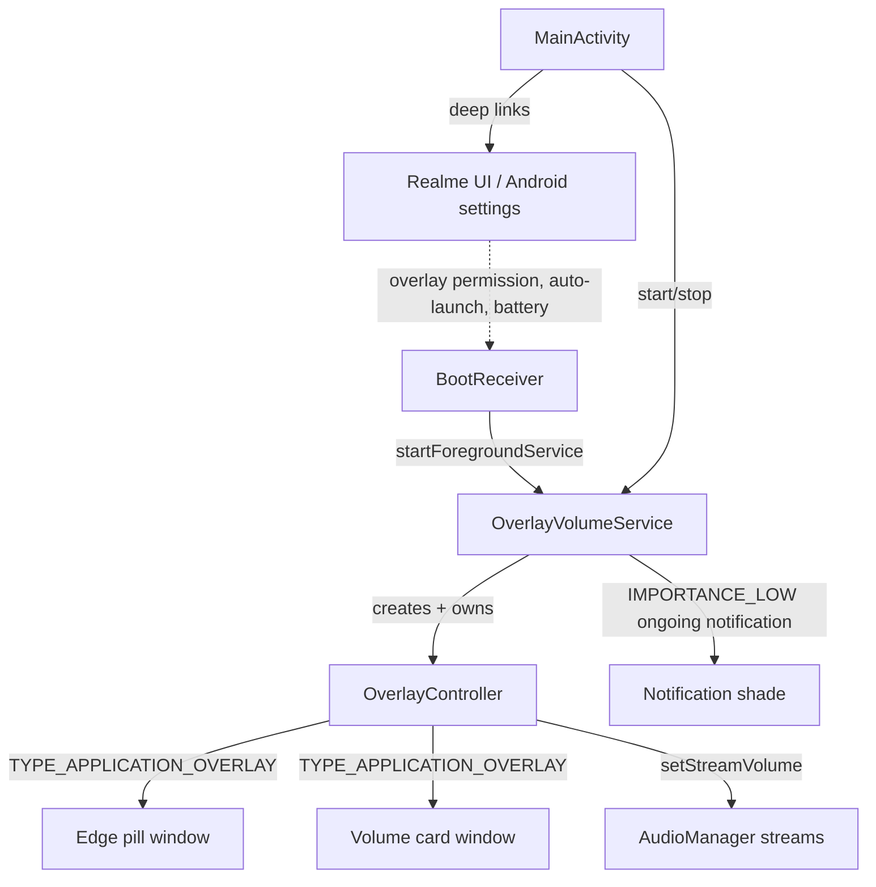
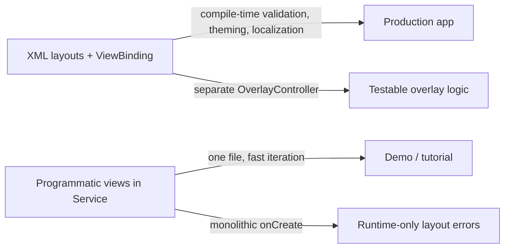

# Architecture (`ARCHITECTURE.md`)
> **1-Line Summary:** How the foreground service, overlay controller and OEM setup launcher fit together, and why the XML/layered approach was chosen over a single programmatic service.

## 1. Subsystem Map

### [SUBSYSTEM: Foreground Service Lifecycle] | Aliases: startForeground, START_STICKY, notification
> **1-Line Summary:** The service is the process anchor: it posts the notification first, then creates the controller, and is recreated by Android after low-memory kills.
* `onCreate()` creates the channel, calls `startForeground(NOTIFICATION_ID, ...)` immediately, then builds `OverlayController` and calls `show()`.
* `onStartCommand()` handles notification actions (media ±, panel toggle, stop) and returns `START_STICKY`.
* `onDestroy()` calls `controller.destroy()` so no overlay windows leak.
* Anchors: `OverlayVolumeService -> onCreate`, `onStartCommand`, `onDestroy`, `buildNotification`.

### [SUBSYSTEM: Overlay Window Management] | Aliases: WindowManager, edge snap, drag, touch
> **1-Line Summary:** One controller owns both overlay windows and every `addView`/`updateViewLayout`/`removeView` call, keeping the service lifecycle clean.
* Both windows use `TYPE_APPLICATION_OVERLAY` (fallback `TYPE_PHONE` below API 26), `FLAG_NOT_FOCUSABLE or FLAG_NOT_TOUCH_MODAL`, `PixelFormat.TRANSLUCENT`, and `Gravity.TOP or Gravity.START`.
* Drag: `ACTION_DOWN` stores layout + raw coordinates; `ACTION_MOVE` sets X freely and snaps Y to a ~16 dp grid; `ACTION_UP` treats sub-slop movement as a click and otherwise animates X to the nearest edge with `ValueAnimator`.
* The panel is pre-measured, positioned beside the docked edge via `positionPanel()`, and re-anchored whenever the handle snaps or the configuration changes.
* Anchors: `OverlayController -> overlayParams`, `attachHandleTouchListener`, `snapToNearestEdge`, `positionPanel`, `configReceiver`.

### [SUBSYSTEM: Volume Mapping] | Aliases: AudioManager, stepped slider, 10 percent
> **1-Line Summary:** Each Material slider is configured programmatically (0–100, `stepSize = 10f`) and converts its percentage to the stream's max volume with rounding/clamping.
* `bindSliders()` wires `Slider.addOnChangeListener`; `isSyncingSliders` prevents feedback loops.
* `streamToPercent()` guards against `max <= 0` to avoid division by zero.
* `syncSlidersFromAudio()` refreshes all four sliders whenever the panel opens.
* Anchors: `OverlayController -> bindSliders`, `syncSlidersFromAudio`, `streamToPercent`.

### [SUBSYSTEM: Boot & OEM Survival] | Aliases: BOOT_COMPLETED, locked boot, auto-launch, battery
> **1-Line Summary:** Boot handling defers locked starts until unlock, and deep-link buttons surface the manual Realme UI settings the OS needs.
* `BOOT_COMPLETED` / `QUICKBOOT_POWERON` / `MY_PACKAGE_REPLACED` start directly; `LOCKED_BOOT_COMPLETED` registers a one-shot `ACTION_USER_UNLOCKED` receiver in device-protected storage.
* Dynamic receivers specify `Context.RECEIVER_EXPORTED` on API 33+ as required.
* `RealmeSettings` tries multiple ColorOS/Realme component names and falls back to App Details.
* Anchors: `BootReceiver -> onReceive`, `waitForUnlock`, `startSafely`; `RealmeSettings -> openAutoLaunch`, `openAppBatteryManagement`.

## 2. Design Rationale (XML + layers vs. single programmatic service)

* **Why XML:** aapt validates layouts at build time; dp dimensions, colours and strings live in resource files; the panel is easier to restyle without touching logic.
* **Why layers:** the service owns only lifecycle and notification duties, so the ~300-line touch/window code stays in `OverlayController` and the OEM deep-links stay in `RealmeSettings`.
* **Trade-off accepted:** more files and a ViewBinding class, but no raw pixel constants, no hardcoded English strings, and no build-breaking legacy manifest `package` attribute.

## 3. Extension Recipes

* **Change drag granularity:** edit `dragStepPx` in `OverlayController` (16 dp default); set to 1 dp for fluid dragging.
* **Change volume intervals:** edit `slider.stepSize = 10f` in `OverlayController -> bindSliders` (5f for 20 steps, 20f for 5 steps).
* **Add a fifth stream:** add a slider id in `volume_panel.xml`, append it to `streamSliderIds` and its `AudioManager.STREAM_*` to `streams` in `OverlayController`; no service changes needed.
* **Add a Realme model:** append a candidate component to the matching list in `RealmeSettings -> openAutoLaunch` / `openAppBatteryManagement`.
