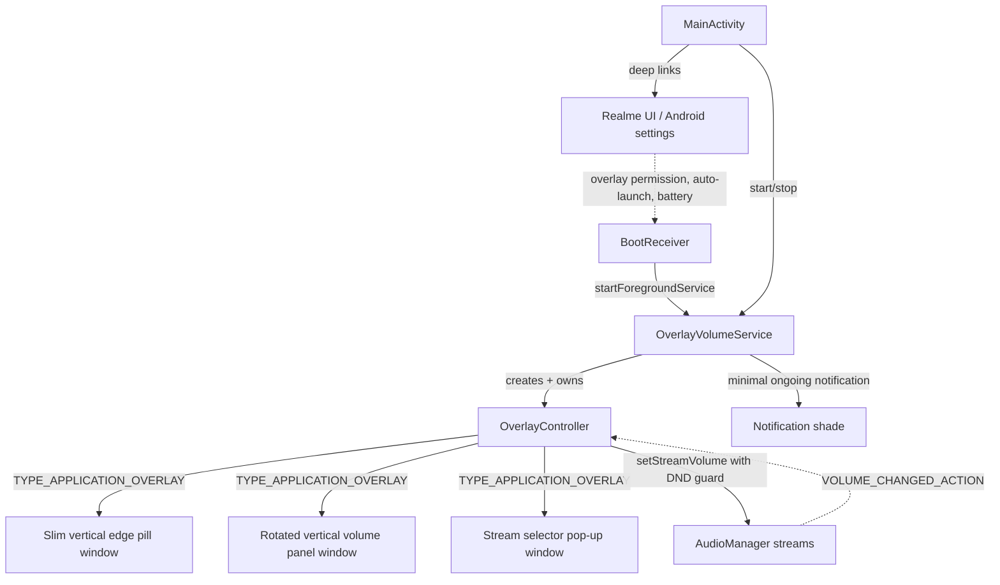
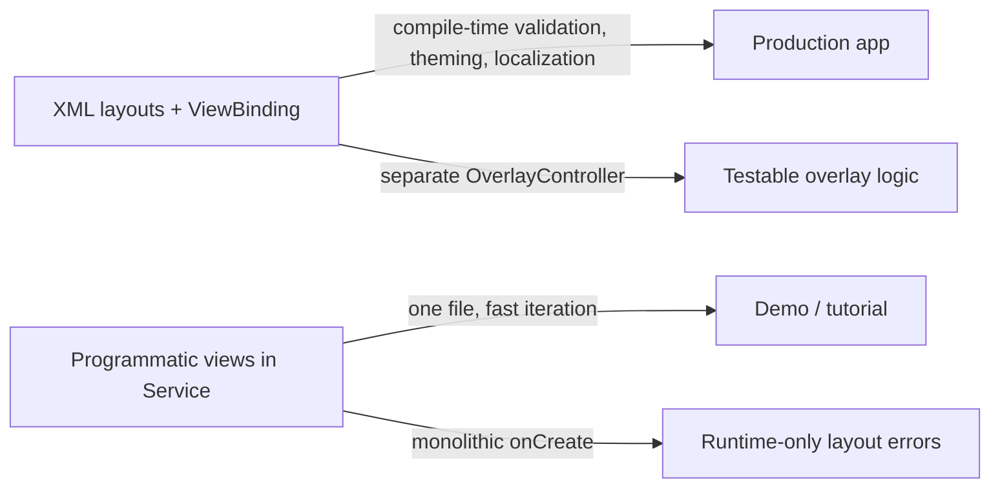

# Architecture (`ARCHITECTURE.md`)
> **1-Line Summary:** How the foreground service, overlay controller and OEM setup launcher fit together, and why the XML/layered approach was chosen over a single programmatic service.

## 1. Subsystem Map

### [SUBSYSTEM: Foreground Service Lifecycle] | Aliases: startForeground, START_STICKY, notification
> **1-Line Summary:** The service is the process anchor: it posts the notification first, then creates the controller, and is recreated by Android after low-memory kills.
* `onCreate()` creates the channel, calls `startForeground(NOTIFICATION_ID, ...)` immediately, builds `OverlayController`, and calls `show()`.
* `onStartCommand()` handles notification toggle actions (`ACTION_TOGGLE_PANEL`, `ACTION_TOGGLE_CHIP`, `ACTION_CYCLE_STREAM`) and returns `START_STICKY`.
* `onDestroy()` calls `controller.destroy()` so no overlay windows or receivers leak.
* Anchors: `OverlayVolumeService -> onCreate`, `onStartCommand`, `onDestroy`, `buildNotification`.

### [SUBSYSTEM: Overlay Window Management] | Aliases: WindowManager, edge snap, drag, touch
> **1-Line Summary:** One controller owns all overlay windows (pill, vertical panel, stream popup, HUD) and every `addView`/`updateViewLayout`/`removeView` call safely.
* All overlay windows use `TYPE_APPLICATION_OVERLAY` (fallback `TYPE_PHONE` below API 26), `FLAG_NOT_FOCUSABLE or FLAG_NOT_TOUCH_MODAL`, `PixelFormat.TRANSLUCENT`, and `Gravity.TOP or Gravity.START`.
* **Slim Edge Pill:** `28×64 dp`. Direct vertical drag adjusts volume (+ UP, - DOWN). Single tap toggles the vertical panel. Long-press (300 ms) unlocks free 2D repositioning with haptic feedback.
* **System Gesture Exclusion:** Calls `setSystemGestureExclusionRects()` on API 29+ with the pill's bounds to prevent accidental Android "Back" gesture triggers.
* **Rotated Vertical Panel:** `54×192 dp`. Positioned flush beside the pill. Features a top stream button, a vertical scrub track (104 dp), and bottom percentage text. Auto-dismisses after 4 seconds of inactivity.
* Anchors: `OverlayController -> overlayParams`, `attachHandleTouch`, `snapToEdge`, `openPanel`, `positionPanel`, `togglePopup`.

### [SUBSYSTEM: Volume Mapping & DND Safety] | Aliases: AudioManager, discrete 10 percent, DND guard
> **1-Line Summary:** Converts vertical touch fractions into discrete 10% steps, guards against Do Not Disturb SecurityException, and syncs external hardware button presses.
* `setPercent()` clamps values, calculates the target stream volume, and wraps `audioManager.setStreamVolume()` in a `try-catch` block catching `SecurityException`.
* `volumeChangeReceiver` listens dynamically for `android.media.VOLUME_CHANGED_ACTION` to sync UI when hardware volume keys are pressed.
* Anchors: `OverlayController -> setPercent`, `currentPercent`, `volumeChangeReceiver`.

### [SUBSYSTEM: Boot & OEM Survival] | Aliases: BOOT_COMPLETED, locked boot, auto-launch, battery
> **1-Line Summary:** Boot handling defers locked starts until unlock, and deep-link buttons surface the manual Realme UI settings the OS needs.
* `BOOT_COMPLETED` / `QUICKBOOT_POWERON` / `MY_PACKAGE_REPLACED` start directly; `LOCKED_BOOT_COMPLETED` only starts if `UserManager.isUserUnlocked` is true.
* Dynamic receivers specify `Context.RECEIVER_EXPORTED` on API 33+ as required.
* `RealmeSettings` tries multiple ColorOS/Realme component names and falls back to App Details.
* Anchors: `BootReceiver -> onReceive`, `startSafely`; `RealmeSettings -> openAutoLaunch`, `openAppBatteryManagement`.

## 2. Design Rationale (XML + layers vs. single programmatic service)

* **Why XML:** aapt validates layouts at build time; dp dimensions, colours and strings live in resource files; the panel is easier to restyle without touching logic.
* **Why layers:** the service owns only lifecycle and notification duties, so the touch/window code stays in `OverlayController` and OEM deep-links stay in `RealmeSettings`.

## 3. Extension Recipes

* **Change drag granularity:** edit `volumeStepPx` in `OverlayController` (14 dp default).
* **Change vertical panel height:** edit `@dimen/vertical_panel_height` in `dimens.xml`.
* **Add a stream to the pop-up:** add an item in `stream_popup.xml`, append its id and `AudioManager.STREAM_*` to `OverlayController`.
* **Add a Realme model:** append a candidate component to the matching list in `RealmeSettings -> openAutoLaunch` / `openAppBatteryManagement`.
