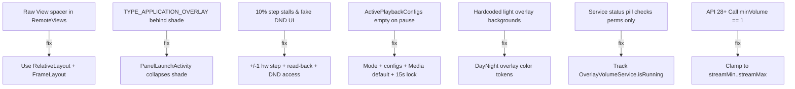

# Decisions & Traps (`DECISIONS_AND_TRAPS.md`)
> **1-Line Summary:** Architectural pivots, rejected alternatives and non-obvious engineering landmines for the Realme 6 volume utility.

## 1. Decisions

### [DECISION: Wide 80×228 dp Vertical Panel & Dual-State Notification] | Aliases: wider panel, vertical slider, compact expanded notification, 5 streams
> **1-Line Summary:** Widened the vertical panel from 54×192 dp to 80×228 dp (48×124 dp track) and split the notification into compact (`<= 48 dp`) and expanded 5-profile `DecoratedCustomViewStyle` layouts.
* **What was rejected:** Single 86 dp custom notification view without `DecoratedCustomViewStyle` (clipped in collapsed state) and cramped 54 dp floating panel.
* **Semantics:** Expanded notification provides 5 direct profile chips (`Media`, `Ring`, `Notify`, `Call`, `Alarm`), `44×44 dp` `[−]`/`[+]` buttons, and a status pill that resets to Auto on tap; floating panel includes stream label + `48×124 dp` track + `164 dp` 6-option popup.
* **Status:** `[DECIDED BY: HUMAN]`
* **Anchors:** `OverlayController -> openPanel`, `openPopup`; `OverlayVolumeService -> buildNotification`; `app/src/main/res/layout/volume_vertical_panel.xml`, `notification_volume_compact.xml`, `notification_volume_expanded.xml`, `stream_popup.xml`.

### [DECISION: Transparent PanelLaunchActivity Over ACTION_CLOSE_SYSTEM_DIALOGS] | Aliases: shade collapse, PanelLaunchActivity, overlay behind shade
> **1-Line Summary:** Launches an empty-task translucent Activity from the notification Panel button to collapse the shade natively before opening the floating overlay.
* **What was rejected:** Calling `startService()` directly from the notification (panel opens invisibly behind the open notification shade) or broadcasting `Intent.ACTION_CLOSE_SYSTEM_DIALOGS` (throws `SecurityException` on API 31+ when targeting 33).
* **Why:** An Activity `PendingIntent` with `android:taskAffinity=""` and `Theme.VolumeManager.Transparent` collapses SystemUI's shade cleanly without pulling `MainActivity` over foreground apps, then triggers `ACTION_OPEN_PANEL` after 180 ms.
* **Status:** `[DECIDED BY: AGENT]`
* **Anchors:** `PanelLaunchActivity -> onCreate`; `OverlayVolumeService -> panelActivityPendingIntent`, `onStartCommand`; `app/src/main/AndroidManifest.xml`.

### [DECISION: Live OS Read-Back, Discrete Hardware Stepping & Smart 15s Lock] | Aliases: volume readback, stepVolume, smart auto detect, manual lock
> **1-Line Summary:** Replaces optimistic percentage math and unconditional Media resets with live `getStreamVolume()` read-back, `±1` discrete hardware steps, and Smart Auto-Detect paired with a 15-second manual lock.
* **What was rejected:** `±10%` rounding (stalls on 5-step Call / 7-step Ring streams), persistent `lastDispatchedStep` caching across stream switches, unconditional `autoFocusMediaIfActive()` overriding manual picks, and silent `SecurityException` swallowing that displayed fake UI percentages.
* **Status:** `[DECIDED BY: AGENT]`
* **Anchors:** `OverlayController -> stepVolume`, `setPercentDuringDrag`, `applyHardwareStep`, `detectSmartStreamIndex`, `resolveStreamForInteraction`, `selectStreamManual`, `enableAutoMode`.

### [DECISION: 48dp Squircle Handle Over 28dp Slim Pill] | Aliases: squircle handle, 48dp, finger touch, tactile handle
> **1-Line Summary:** Replaced the 28 dp slim pill with a 48×48 dp squircle with 16dp rounded corners for reliable finger touch and smooth drag.
* **What was rejected:** 28 dp slim pill (user feedback: "way too slim, cannot even use finger properly").
* **Semantics:** Direct swipe UP increases volume, swipe DOWN decreases volume, single tap toggles the vertical panel, and long-press (320 ms) unlocks free repositioning with haptic feedback.
* **Status:** `[DECIDED BY: HUMAN]`
* **Anchors:** `OverlayController -> attachHandleTouch`; `app/src/main/res/layout/floating_handle.xml`; `app/src/main/res/values/dimens.xml`.

### [DECISION: Concept 4 Prism Speaker App Launcher Icon] | Aliases: prism speaker, app icon, logo redesign
> **1-Line Summary:** Replaced legacy purple circle logo with Concept 4 (Prism Speaker): isometric acoustic cone, facet highlight, and multi-tier sound waves.
* **Status:** `[DECIDED BY: HUMAN]`
* **Anchors:** `app/src/main/res/drawable/ic_launcher_foreground.xml`; `app/src/main/res/values/colors.xml` -> `ic_launcher_background`.

### [DECISION: Zero-Lag Binder IPC Throttling] | Aliases: zero lag, IPC throttling, performance optimization
> **1-Line Summary:** Dispatches drag volume changes across Binder IPC to `system_server` only when the discrete integer volume step changes within the active gesture.
* **Status:** `[DECIDED BY: AGENT]`
* **Anchors:** `OverlayController -> setPercentDuringDrag`, `applyHardwareStep`.

### [DECISION: Layered XML Project Over Single Programmatic Service] | Aliases: XML vs programmatic, architecture choice
> **1-Line Summary:** Chose XML layouts plus a dedicated `OverlayController` instead of building all views inside the service.
* **Status:** `[DECIDED BY: HUMAN]`
* **Anchors:** `app/src/main/java/com/volumemanager/overlay/OverlayController.kt`.

### [DECISION: Namespace Only, No Manifest Package] | Aliases: AGP 8, namespace, build fix
> **1-Line Summary:** The module declares `namespace` in Gradle and omits the legacy `package` attribute from the manifest.
* **Status:** `[DECIDED BY: AGENT]`
* **Anchors:** `app/build.gradle.kts` -> `namespace`, `app/src/main/AndroidManifest.xml`.

### [DECISION: Guard Overlay Access Inside the Service Too] | Aliases: permission revoke, crash prevention
> **1-Line Summary:** `OverlayController -> show()`, `togglePanel()`, and `openPanelFromNotification()` re-check `Settings.canDrawOverlays` before touching `WindowManager`.
* **Status:** `[DECIDED BY: AGENT]`
* **Anchors:** `OverlayController -> show`, `togglePanel`, `openPanelFromNotification`.

### [DECISION: Pre-Flight RemoteViews Validation, Offline Crash Reporter & Release Lint Gate] | Aliases: RemoteViews preflight, stock fallback, crash reporter, release lint gate
> **1-Line Summary:** Validates custom `RemoteViews` in-process with automatic stock notification fallback, records uncaught crashes offline without adding `INTERNET`, and gates release APK builds on `lintDebug`.
* **Why:** A single `RemoteViewLayout` XML mistake in `v1.3.1` slipped past `release.yml` (which omitted `lintDebug`) and triggered fatal `RemoteServiceException` crash loops on Android 11 without any visible stack trace on the handset.
* **Status:** `[DECIDED BY: HUMAN]`
* **Anchors:** `VolumeManagerApp -> onCreate`; `CrashReporter -> install`, `buildFullBugReport`; `OverlayVolumeService -> safeBuildNotification`, `validateRemoteViews`, `buildStockFallbackNotification`; `.github/workflows/release.yml`.

### [DECISION: Hybrid Architecture [2A] — Custom Panel Plus Quick Settings Native Volume Backup] | Aliases: 2A hybrid, Quick Settings tile, native system slider
> **1-Line Summary:** Keeps the custom `80×228 dp` vertical panel and 5-profile expanded notification while adding `VolumeTileService` and an in-app button that summon Realme UI's native multi-stream slider (`FLAG_SHOW_UI`).
* **Why:** Preserves fast one-handed edge scrubbing and direct 5-stream shade controls while giving users an OS-native fallback that still works even if OEM battery rules pause the overlay service.
* **Status:** `[DECIDED BY: HUMAN]`
* **Anchors:** `VolumeTileService -> onStartListening`, `onClick`; `PanelLaunchActivity -> showSystemVolumeUi`; `MainActivity -> onCreate` (`btnSystemVolume`).

## 2. Traps

### [TRAP: Non-RemoteView Tags Break Notification & Fail CI Lint] | Aliases: RemoteViewLayout, lint failure, View spacer
> **1-Line Summary:** Using `<View>` (or `<Space>`) inside a `RemoteViews` notification layout fails `lintDebug` (`RemoteViewLayout`) and causes Android 11 SystemUI to reject the notification layout.
* **Avoidance:** Restrict `notification_volume_compact.xml` and `notification_volume_expanded.xml` strictly to `LinearLayout`, `RelativeLayout`, `FrameLayout`, `TextView`, `ImageView`, and `ProgressBar`.
* **Anchors:** `app/src/main/res/layout/notification_volume_compact.xml`, `app/src/main/res/layout/notification_volume_expanded.xml`.

### [TRAP: Overlay Panel Opens Behind Notification Shade] | Aliases: TYPE_APPLICATION_OVERLAY, notification shade, z-order
> **1-Line Summary:** `TYPE_APPLICATION_OVERLAY` windows always render underneath the expanded notification shade on Android 8+, hiding the panel if launched directly by a `Service` `PendingIntent`.
* **Avoidance:** Route notification panel buttons through `PanelLaunchActivity` (`PendingIntent.getActivity`) so SystemUI collapses the shade natively before opening the panel.
* **Anchors:** `PanelLaunchActivity -> onCreate`; `OverlayVolumeService -> panelActivityPendingIntent`.

### [TRAP: DND SecurityException & Silent Fake UI Updates] | Aliases: DND, Zen mode, mute crash, fake volume
> **1-Line Summary:** Modifying `STREAM_RING` or `STREAM_NOTIFICATION` in DND/Silent throws `SecurityException` without `ACCESS_NOTIFICATION_POLICY`, and echoing optimistic target percentages makes the UI lie.
* **Avoidance:** Catch `SecurityException`, read back `audioManager.getStreamVolume()` unconditionally after every write, display `"Blocked by DND"` in the HUD on failure, and surface optional DND policy access in `MainActivity`.
* **Anchors:** `OverlayController -> applyHardwareStep`; `Permissions -> hasNotificationPolicyAccess`, `notificationPolicyAccessIntent`.

### [TRAP: ActivePlaybackConfigurations Drops Paused Media On API 26–30] | Aliases: YouTube paused, activePlaybackConfigurations, isMusicActive
> **1-Line Summary:** On Android 8–11, `getActivePlaybackConfigurations()` removes paused/buffering players immediately, leaving the active list empty when YouTube is paused.
* **Avoidance:** Check `audioManager.mode` and active playback usages for calls, ringtones, and alarms, check `isMusicActive` for media, and fall back to `STREAM_MUSIC` when idle/paused while honoring a 15-second manual override lock.
* **Anchors:** `OverlayController -> detectSmartStreamIndex`, `resolveStreamForInteraction`, `registerPlaybackCallbackO`.

### [TRAP: Stream Minimum Volume Above Zero On Call & Alarm] | Aliases: getStreamMinVolume, STREAM_VOICE_CALL, clamp
> **1-Line Summary:** On Android 9+, `STREAM_VOICE_CALL` typically has a hardware minimum of `1` instead of `0`; mapping to `0` causes silent off-by-one drags.
* **Avoidance:** Query `audioManager.getStreamMinVolume(stream)` on API 28+ (`streamMin`) and clamp/map across `[min, max]`.
* **Anchors:** `OverlayController -> streamMin`, `percentToStep`, `stepVolume`, `applyHardwareStep`.

### [TRAP: Hardcoded Light Drawables With DayNight Text Colors] | Aliases: invisible dark mode text, panel_vertical_background, floating_hud
> **1-Line Summary:** Mixing hardcoded `#FAFAFD` drawable backgrounds with `@color/text_primary` (`#F8FAFC` in Dark Mode) renders vertical panel and popup labels unreadable in Dark Mode.
* **Avoidance:** Route all overlay surfaces, tracks, option rows, and status chips through DayNight color tokens (`values/` + `values-night/`) and pair `values-night/themes.xml` (`windowLightStatusBar = false`).
* **Anchors:** `app/src/main/res/values/colors.xml`, `app/src/main/res/values-night/colors.xml`, `app/src/main/res/values-night/themes.xml`.

### [TRAP: Service Status Pill Inferring Running State From Permissions] | Aliases: statusPillService, Active Running when stopped
> **1-Line Summary:** Reporting `"Active • Running"` purely from granted permissions misleads users when `OverlayVolumeService` is actually stopped.
* **Avoidance:** Track real lifecycle state via `OverlayVolumeService.isRunning` and `onRunningStateChanged` and display `Active • Running`, `Stopped`, or `Setup Required` accordingly.
* **Anchors:** `OverlayVolumeService -> isRunning`, `onRunningStateChanged`; `MainActivity -> updateStatus`.

### [TRAP: Android 10+ Back Gesture Edge Collision] | Aliases: gesture navigation, back swipe, exclusion rect
> **1-Line Summary:** Swiping on an edge-docked handle on Android 10+ triggers the system "Back" gesture unless explicitly excluded.
* **Avoidance:** Call `View.setSystemGestureExclusionRects()` on the handle view with its current window bounds on API 29+.
* **Anchors:** `OverlayController -> updateGestureExclusion`.

### [TRAP: Hardware Volume Rocker Desync] | Aliases: physical keys, bluetooth volume, desync
> **1-Line Summary:** Adjusting volume via hardware buttons or headsets leaves the overlay and notification out of sync.
* **Avoidance:** Register a dynamic receiver for `android.media.VOLUME_CHANGED_ACTION` to refresh UI levels whenever external audio changes occur, ignoring mismatched background streams so Notification alerts do not hijack Media.
* **Anchors:** `OverlayController -> volumeChangeReceiver`.

### [TRAP: Raw Pixel Dimensions & Hardcoded Track Height] | Aliases: px vs dp, vertical_track_height, density
> **1-Line Summary:** Raw pixel sizes shrink on 440 dpi displays, and hardcoding `dp(104f)` in Kotlin desyncs fill-bar math when `dimens.xml` changes.
* **Avoidance:** Define overlay dimensions in `dimens.xml` and read them via `getDimensionPixelSize` or `trackFrame.height`.
* **Anchors:** `OverlayController -> updateTrackHeight`; `app/src/main/res/values/dimens.xml`.

### [TRAP: Literal Percent Signs In Strings] | Aliases: StringFormatInvalid, lint, 10%
> **1-Line Summary:** A string containing `10%` or `0%` is treated as a format specifier by lint and fails the build.
* **Avoidance:** Mark such strings `formatted="false"` (or escape as `%%`); format strings use positional specifiers with arguments.
* **Anchors:** `app/src/main/res/values/strings.xml`.

### [TRAP: Dynamic Receiver Flags on API 33+] | Aliases: RECEIVER_EXPORTED, SecurityException
> **1-Line Summary:** Registering a receiver for a system broadcast without an export flag throws on API 33+ when targeting 33.
* **Avoidance:** Use the three-argument `registerReceiver(receiver, filter, Context.RECEIVER_EXPORTED)` on TIRAMISU+.
* **Anchors:** `OverlayController -> registerReceivers`.

### [TRAP: 90Hz/120Hz Binder IPC Flooding on Touch Move] | Aliases: phone lag, high CPU, system_server freeze, AudioService contention
> **1-Line Summary:** Calling `audioManager.setStreamVolume` on every pixel during 90Hz/120Hz touch events causes severe Binder thread contention and device lag.
* **Avoidance:** Compare `targetStep` against gesture-local `dragLastSentStep` and only dispatch `setStreamVolume()` when the integer volume step changes; debounce drag notification updates by 200 ms.
* **Anchors:** `OverlayController -> setPercentDuringDrag`; `OverlayVolumeService -> scheduleNotificationRefresh`.

### [TRAP: Google Play Protect Sideloading Warning on SYSTEM_ALERT_WINDOW] | Aliases: play protect warning, unrecognized developer, blocked app
> **1-Line Summary:** Sideloading a self-signed APK requesting `SYSTEM_ALERT_WINDOW` triggers a prominent Play Protect defense warning.
* **Avoidance:** Ensure zero internet permissions (`android.permission.INTERNET` omitted) so the app is provably offline.
* **Anchors:** `app/src/main/AndroidManifest.xml`.

### [TRAP: Tight Touch Slop Swallowing Taps] | Aliases: tap not opening panel, touch slop, micro tremors
> **1-Line Summary:** Hardcoding touch slop to a small value causes natural thumb micro-jitter to be classified as a move, preventing tap actions.
* **Avoidance:** Always use `ViewConfiguration.get(context).scaledTouchSlop` so taps register cleanly.
* **Anchors:** `OverlayController -> attachHandleTouch`.

### [TRAP: Ephemeral CI Keystore Breaks Over-The-Air APK Updates] | Aliases: cannot update, install failed update incompatible, signature mismatch
> **1-Line Summary:** Generating a new RSA keystore inside ephemeral CI containers causes every build to have a different signature.
* **Avoidance:** Store a permanent release keystore in GitHub repository secrets (`RELEASE_KEYSTORE_BASE64`) and local backup.
* **Anchors:** `.github/workflows/release.yml` -> `Prepare signing keystore`.

### [TRAP: Root Touch Listener Starving Child Click Events On Overlay] | Aliases: popup menu not opening, stream icon click, touch intercept
> **1-Line Summary:** Setting `view.setOnTouchListener` returning `true` on the panel root consumes `ACTION_DOWN`, preventing child views like `btn_stream_icon` from receiving clicks.
* **Avoidance:** Return `false` on `ACTION_DOWN` when the raw touch coordinate falls inside `btn_stream_icon`'s bounding `Rect`.
* **Anchors:** `OverlayController -> openPanel`, `btn_stream_icon`.

### [TRAP: Android 11 Service WindowMetrics Crash In Multi-Window / PiP] | Aliases: split screen crash, pip crash, currentWindowMetrics exception
> **1-Line Summary:** Calling `windowManager.currentWindowMetrics` from a non-visual Service context during split-screen or PiP on Android 11 throws `IllegalStateException`/`IllegalArgumentException`.
* **Avoidance:** Use `context.resources.displayMetrics` as the primary screen dimension source with `FLAG_LAYOUT_IN_SCREEN` and `resizeableActivity="true"`.
* **Anchors:** `OverlayController -> screenSize`, `overlayParams`, `configReceiver`; `app/src/main/AndroidManifest.xml` -> `MainActivity`.

## 3. Verification Gate

### [VERIFY: CI And Release Verified On GitHub] | Aliases: assembleDebug, lintDebug, tag release, arm64
> **1-Line Summary:** The authoring machine has no JDK/SDK, so verification runs in GitHub Actions (`assembleDebug` + `lintDebug`), and releases require passing `lintDebug` before building signed APKs.
* **CI status:** Runs `assembleDebug` + `lintDebug` on every push to `main`.
* **Release status:** Triggered by annotated tags (e.g. `v1.4.0`) on explicit user instruction; runs `./gradlew lintDebug` as a mandatory gate before `assembleRelease`.
