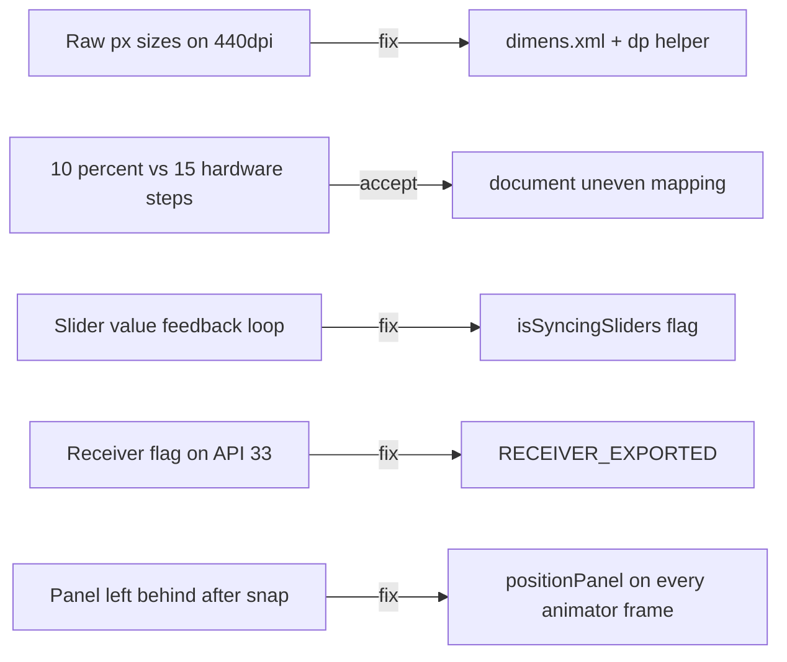

# Decisions & Traps (`DECISIONS_AND_TRAPS.md`)
> **1-Line Summary:** Architectural pivots, rejected alternatives and non-obvious engineering landmines for the Realme 6 volume utility.

## 1. Decisions

### [DECISION: Layered XML Project Over Single Programmatic Service] | Aliases: XML vs programmatic, architecture choice
> **1-Line Summary:** Chose XML layouts plus a dedicated `OverlayController` instead of building all views inside the service.
* **What was rejected:** A single `OverlayVolumeService.kt` that inflates handle/panel with `GradientDrawable` and raw pixel sizes.
* **Why:** Compile-time layout validation, proper dp/theme/string resources, and a service that only handles lifecycle. The programmatic version is still the better teaching artifact.
* **Status:** `[DECIDED BY: HUMAN]` (chose "Go ahead with your approach" after the comparison).
* **Anchors:** `app/src/main/java/com/volumemanager/overlay/OverlayController.kt`, `app/src/main/res/layout/volume_panel.xml`.

### [DECISION: Namespace Only, No Manifest Package] | Aliases: AGP 8, namespace, build fix
> **1-Line Summary:** The module declares `namespace` in Gradle and omits the legacy `package` attribute from the manifest.
* **Why:** AGP 8 fails the build with "Setting the namespace via the package attribute is no longer supported". The evaluated reference code used the legacy attribute.
* **Status:** `[DECIDED BY: AGENT]`
* **Anchors:** `app/build.gradle.kts` -> `namespace`, `app/src/main/AndroidManifest.xml`.

### [DECISION: Defer Locked-Boot Start Until Unlock] | Aliases: LOCKED_BOOT_COMPLETED, direct boot, auto-start
> **1-Line Summary:** `LOCKED_BOOT_COMPLETED` registers a one-shot `ACTION_USER_UNLOCKED` receiver instead of starting the service immediately.
* **Why:** The service is not `directBootAware`, and `TYPE_APPLICATION_OVERLAY` cannot draw over the lock screen anyway. The reference code's immediate start would throw or be dropped.
* **Status:** `[DECIDED BY: AGENT]`
* **Anchors:** `BootReceiver -> onReceive`, `waitForUnlock`, `startSafely`.

### [DECISION: Guard Overlay Access Inside the Service Too] | Aliases: permission revoke, crash prevention
> **1-Line Summary:** `OverlayController -> show()` and `togglePanel()` both re-check `Settings.canDrawOverlays` before touching `WindowManager`.
* **Why:** The boot receiver and MainActivity check once, but a notification action fired after the user revokes the permission would otherwise throw and kill the service.
* **Status:** `[DECIDED BY: AGENT]`
* **Anchors:** `OverlayController -> show`, `togglePanel`; `OverlayVolumeService -> onOverlayPermissionMissing`.

## 2. Traps

### [TRAP: Raw Pixel Dimensions] | Aliases: px vs dp, tiny handle, density
> **1-Line Summary:** Hardcoded `36 px` width on a ~440 dpi Realme 6 is about 6 dp — effectively invisible.
* **Avoidance:** All sizes come from `dimens.xml` or `OverlayController -> dp()`.

### [TRAP: Percentage Steps Are Not Hardware Steps] | Aliases: 10 percent, 15 steps, rounding
> **1-Line Summary:** Mapping 0–100% in 10% increments onto a 15-step stream makes some steps advance volume by 1 and others by 2.
* **Avoidance:** Documented in `README.md`; finer control is a wishlist item using `LoudnessEnhancer`.

### [TRAP: Slider Feedback Loop] | Aliases: onChangeListener, programmatic value
> **1-Line Summary:** Calling `slider.value = ...` inside `syncSlidersFromAudio()` can re-trigger the change listener and rewrite system volume.
* **Avoidance:** Check `fromUser` and guard with `isSyncingSliders` in `bindSliders`.

### [TRAP: Dynamic Receiver Flags on API 33+] | Aliases: RECEIVER_EXPORTED, SecurityException
> **1-Line Summary:** Registering a receiver for a system broadcast without an export flag throws on API 33+ when targeting 33.
* **Avoidance:** Use the three-argument `registerReceiver(receiver, filter, Context.RECEIVER_EXPORTED)` on TIRAMISU+.

### [TRAP: Panel Does Not Follow the Handle] | Aliases: snap animation, stale panel position
> **1-Line Summary:** Animating only the handle's X leaves the panel stranded if it is open when the pill snaps to the other edge.
* **Avoidance:** Call `positionPanel()` from the `ValueAnimator` update listener.

### [TRAP: Realme UI Component Names Vary] | Aliases: ColorOS, StartupAppListActivity, deep link
> **1-Line Summary:** Auto-launch / battery components differ between Realme UI builds; a single hard-coded component often fails.
* **Avoidance:** `RealmeSettings` tries several candidates and falls back to `ACTION_APPLICATION_DETAILS_SETTINGS`.

## 3. Verification Gate

### [VERIFY: CI And Release Verified On GitHub] | Aliases: assembleDebug, lintDebug, tag release, arm64
> **1-Line Summary:** The authoring machine had no JDK/SDK, so verification ran in GitHub Actions; CI passed and the `v1.0.0` tag produced a signed arm64-v8a APK.
* **Local limitation:** No JDK 17 / Android SDK / Gradle toolchain here, so `.\gradlew` was not run locally.
* **CI result:** `assembleDebug` + `lintDebug` passed on commit `6c773df` (run `44284243727`) after fixing the `DecelerateInterpolator` import and replacing the platform `Notification.Builder` with `NotificationCompat.Builder` for API 23 lint compliance.
* **Release result:** Tag `v1.0.0` triggered workflow run `44284766559`, which published `VolumeManager-arm64-v8a-v1.0.0.apk` (4,889,062 bytes) on the GitHub Release; the APK contains `META-INF/CERT.SF` and `META-INF/CERT.RSA` and is therefore signed.
* **Ongoing:** CI still gates every push and PR to `main`. Re-run `.\gradlew assembleDebug lintDebug` locally if the toolchain becomes available.
