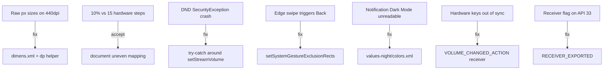

# Decisions & Traps (`DECISIONS_AND_TRAPS.md`)
> **1-Line Summary:** Architectural pivots, rejected alternatives and non-obvious engineering landmines for the Realme 6 volume utility.

## 1. Decisions

### [DECISION: Rotated Vertical Slider Over Horizontal Card] | Aliases: vertical slider, no empty space, user sketch
> **1-Line Summary:** Replaced the wide horizontal card with a compact 54×192 dp rotated vertical slider. Drag UP = louder, Drag DOWN = quieter.
* **What was rejected:** Horizontal card with horizontal SeekBar and wasted empty whitespace.
* **Why:** The user annotated the horizontal layout as "Empty" and requested a vertical orientation to match the physical orientation of volume rocker keys and modern OS sliders.
* **Status:** `[DECIDED BY: HUMAN]`
* **Anchors:** `OverlayController -> openPanel`, `vertical_track_frame`; `app/src/main/res/layout/volume_vertical_panel.xml`.

### [DECISION: Slim 28dp Flush Edge Pill With Multi-Touch Semantics] | Aliases: slim handle, 28dp, direct drag, hold to move
> **1-Line Summary:** Replaced the 44 dp round circle with a slim 28×64 dp filled vertical pill docked flush to the screen edge.
* **Semantics:** Direct swipe UP increases volume, swipe DOWN decreases volume, single tap toggles the vertical panel, and long-press (300 ms) unlocks free repositioning with haptic feedback.
* **Status:** `[DECIDED BY: HUMAN]`
* **Anchors:** `OverlayController -> attachHandleTouch`; `app/src/main/res/layout/floating_handle.xml`.

### [DECISION: Ultra-Compact Symmetrical Notification] | Aliases: green ball notification, minimal shade, centered
> **1-Line Summary:** Streamlined notification to minimal vertical height with centered, symmetrical alignment and theme-adaptive colors.
* **Semantics:** Stream title and volume level centered on top; tapping cycles streams; centered progress bar underneath with green ball styling.
* **Status:** `[DECIDED BY: HUMAN]`
* **Anchors:** `OverlayVolumeService -> buildNotification`; `app/src/main/res/layout/notification_volume.xml`.

### [DECISION: Layered XML Project Over Single Programmatic Service] | Aliases: XML vs programmatic, architecture choice
> **1-Line Summary:** Chose XML layouts plus a dedicated `OverlayController` instead of building all views inside the service.
* **Status:** `[DECIDED BY: HUMAN]`
* **Anchors:** `app/src/main/java/com/volumemanager/overlay/OverlayController.kt`.

### [DECISION: Namespace Only, No Manifest Package] | Aliases: AGP 8, namespace, build fix
> **1-Line Summary:** The module declares `namespace` in Gradle and omits the legacy `package` attribute from the manifest.
* **Status:** `[DECIDED BY: AGENT]`
* **Anchors:** `app/build.gradle.kts` -> `namespace`, `app/src/main/AndroidManifest.xml`.

### [DECISION: Guard Overlay Access Inside the Service Too] | Aliases: permission revoke, crash prevention
> **1-Line Summary:** `OverlayController -> show()` and `togglePanel()` re-check `Settings.canDrawOverlays` before touching `WindowManager`.
* **Status:** `[DECIDED BY: AGENT]`
* **Anchors:** `OverlayController -> show`, `togglePanel`.

## 2. Traps

### [TRAP: Do Not Disturb SecurityException Crash] | Aliases: DND, Zen mode, mute crash
> **1-Line Summary:** Scrubbing ring or notification streams while DND or Silent mode is active throws a SecurityException without NotificationPolicyAccess.
* **Avoidance:** Wrap `audioManager.setStreamVolume()` in a `try-catch` block catching `SecurityException` and log a warning without killing the service.
* **Anchors:** `OverlayController -> setPercent`.

### [TRAP: Android 10+ Back Gesture Edge Collision] | Aliases: gesture navigation, back swipe, exclusion rect
> **1-Line Summary:** Swiping on an edge-docked handle on Android 10+ triggers the system "Back" gesture unless explicitly excluded.
* **Avoidance:** Call `View.setSystemGestureExclusionRects()` on the handle view with its current window bounds on API 29+.
* **Anchors:** `OverlayController -> updateGestureExclusion`.

### [TRAP: Notification Dark Mode Contrast Failure] | Aliases: dark mode invisible text, #1A1A24
> **1-Line Summary:** Hardcoding text colors to `#1A1A24` makes custom RemoteViews unreadable against dark notification shade backgrounds.
* **Avoidance:** Use dynamic theme-aware styling and provide night-qualified color resources (`values-night/colors.xml`).
* **Anchors:** `app/src/main/res/layout/notification_volume.xml`, `app/src/main/res/values-night/colors.xml`.

### [TRAP: Hardware Volume Rocker Desync] | Aliases: physical keys, bluetooth volume, desync
> **1-Line Summary:** Adjusting volume via hardware buttons or headsets leaves the overlay and notification out of sync.
* **Avoidance:** Register a dynamic receiver for `android.media.VOLUME_CHANGED_ACTION` to refresh UI levels whenever external audio changes occur.
* **Anchors:** `OverlayController -> volumeChangeReceiver`.

### [TRAP: Raw Pixel Dimensions] | Aliases: px vs dp, tiny handle, density
> **1-Line Summary:** Hardcoded `36 px` width on a ~440 dpi Realme 6 is about 6 dp — effectively invisible.
* **Avoidance:** All sizes come from `dimens.xml` or `OverlayController -> dp()`.

### [TRAP: Literal Percent Signs In Strings] | Aliases: StringFormatInvalid, lint, 10%
> **1-Line Summary:** A string containing `10%` or `0%` is treated as a format specifier by lint and fails the build.
* **Avoidance:** Mark such strings `formatted="false"` (or escape as `%%`); `notif_status` legitimately uses `%1$s` and `%2$d%%` with arguments.

### [TRAP: Dynamic Receiver Flags on API 33+] | Aliases: RECEIVER_EXPORTED, SecurityException
> **1-Line Summary:** Registering a receiver for a system broadcast without an export flag throws on API 33+ when targeting 33.
* **Avoidance:** Use the three-argument `registerReceiver(receiver, filter, Context.RECEIVER_EXPORTED)` on TIRAMISU+.

## 3. Verification Gate

### [VERIFY: CI And Release Verified On GitHub] | Aliases: assembleDebug, lintDebug, tag release, arm64
> **1-Line Summary:** The authoring machine had no JDK/SDK, so verification ran in GitHub Actions; CI passed and releases produce signed arm64-v8a APKs.
* **CI status:** Runs `assembleDebug` + `lintDebug` on every push to `main`.
* **Release status:** Triggered by annotated tags (e.g. `v1.2.0`), compiling and publishing signed APKs to GitHub Releases.
