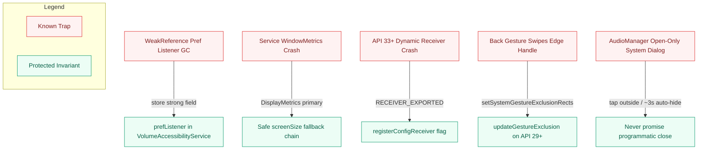

# Decisions & Traps (`DECISIONS_AND_TRAPS.md`)
> **1-Line Summary:** Architectural pivots, branch archive decisions, and non-obvious Android / Realme UI engineering traps.

## 1. Decisions

### [DECISION: Ultra-Lightweight Accessibility Launcher Over Custom Overlay Service] | Aliases: bravo 1, native slider, zero notification, archive branch, lightweight
> **1-Line Summary:** Replaced the foreground service, custom vertical slider, 5-stream selector, and 40%-shade notification with an `AccessibilityService` floating button that opens Realme's native system volume dialog (`FLAG_SHOW_UI`), preserving the full custom build on `archive/full-custom-panel`.
* **What was rejected:** Continuing to maintain a custom foreground service + `DecoratedCustomViewStyle` notification card (consumed ~40% of the notification shade, triggered Android's `"displaying over other apps"` system notice, and suffered Realme UI background/service restrictions outside the app) or switching to a third-party FOSS app.
* **Semantics:** Single tap on the floating squircle opens Realme's native system volume slider; drag or hold repositions and snaps to screen edges; an in-app switch toggles button visibility without disabling Accessibility; Quick Settings `Volume` tile remains as a zero-battery backup.
* **Status:** `[DECIDED BY: HUMAN]`
* **Anchors:** `app/src/main/java/com/volumemanager/VolumeAccessibilityService.kt :: onServiceConnected`, `app/src/main/java/com/volumemanager/overlay/FloatingButtonOverlay.kt :: attachHandleTouch`, `app/src/main/java/com/volumemanager/util/SystemVolumeHelper.kt :: showSystemVolumeUi`, `app/src/main/java/com/volumemanager/MainActivity.kt :: onCreate`.

### [DECISION: Non-Invasive Accessibility Configuration] | Aliases: canRetrieveWindowContent, privacy, zero event wakeups
> **1-Line Summary:** Configures `accessibility_service_config.xml` with `canRetrieveWindowContent="false"` and no event types so the service hosts `TYPE_ACCESSIBILITY_OVERLAY` without reading screen content or waking on UI events.
* **Status:** `[DECIDED BY: AGENT]`
* **Anchors:** `app/src/main/res/xml/accessibility_service_config.xml`, `app/src/main/java/com/volumemanager/VolumeAccessibilityService.kt :: onAccessibilityEvent`.

### [DECISION: Transparent PanelLaunchActivity Over ACTION_CLOSE_SYSTEM_DIALOGS] | Aliases: shade collapse, PanelLaunchActivity, quick settings tile
> **1-Line Summary:** Uses an empty-task translucent Activity from `VolumeTileService` to collapse the Quick Settings shade natively before invoking `AudioManager.adjustVolume(..., FLAG_SHOW_UI)`.
* **What was rejected:** Broadcasting `Intent.ACTION_CLOSE_SYSTEM_DIALOGS` (restricted/throws `SecurityException` on API 31+ when targeting 33).
* **Status:** `[DECIDED BY: AGENT]`
* **Anchors:** `app/src/main/java/com/volumemanager/PanelLaunchActivity.kt :: onCreate`, `app/src/main/java/com/volumemanager/VolumeTileService.kt :: onClick`.

### [DECISION: Concept 4 Prism Speaker App Launcher Icon] | Aliases: prism speaker, app icon, logo redesign
> **1-Line Summary:** Uses Concept 4 (Prism Speaker): isometric acoustic cone, facet highlight, and multi-tier sound waves.
* **Status:** `[DECIDED BY: HUMAN]`
* **Anchors:** `app/src/main/res/drawable/ic_launcher_foreground.xml`, `app/src/main/res/values/colors.xml :: ic_launcher_background`.

### [DECISION: Namespace Only, No Manifest Package] | Aliases: AGP 8, namespace, build fix
> **1-Line Summary:** The module declares `namespace` in Gradle and omits the legacy `package` attribute from the manifest.
* **Status:** `[DECIDED BY: AGENT]`
* **Anchors:** `app/build.gradle.kts :: namespace`, `app/src/main/AndroidManifest.xml`.

### [DECISION: Offline Crash Reporter & Release Lint Gate] | Aliases: crash reporter, release lint gate, diagnostics
> **1-Line Summary:** Records uncaught exceptions and runtime events offline in app-private storage without `INTERNET`, and gates release APK builds on `lintDebug`.
* **Status:** `[DECIDED BY: HUMAN]`
* **Anchors:** `app/src/main/java/com/volumemanager/VolumeManagerApp.kt :: onCreate`, `app/src/main/java/com/volumemanager/util/CrashReporter.kt :: install`, `.github/workflows/release.yml`.

## 2. Traps

### [TRAP: SharedPreferences WeakReference Drops Anonymous Listeners] | Aliases: OnSharedPreferenceChangeListener, WeakHashMap, live settings not updating
> **1-Line Summary:** Android's `SharedPreferencesImpl` holds listeners in a `WeakHashMap`, silently garbage-collecting inline/anonymous preference listeners in background services.
* **Avoidance:** Store `prefListener` as a `private val` member on `VolumeAccessibilityService` and explicitly unregister it in `cleanup()`.
* **Protected Code Anchors:** `app/src/main/java/com/volumemanager/VolumeAccessibilityService.kt :: prefListener`, `app/src/main/java/com/volumemanager/VolumeAccessibilityService.kt :: cleanup`.

### [TRAP: AudioManager.adjustVolume Cannot Programmatically Dismiss SystemUI Slider] | Aliases: toggle off system slider, FLAG_SHOW_UI, FLAG_HIDE_UI
> **1-Line Summary:** `AudioManager.adjustVolume(ADJUST_SAME, FLAG_SHOW_UI)` can open or refresh Realme's system volume dialog, but Android exposes no public flag to close it on a second tap.
* **Avoidance:** Document and design around tap-to-open (tapping outside the system dialog or waiting ~3 seconds dismisses it natively), while providing an instant in-app switch (`switchFloatingButton`) to toggle the floating button itself on and off.
* **Protected Code Anchors:** `app/src/main/java/com/volumemanager/util/SystemVolumeHelper.kt :: showSystemVolumeUi`, `app/src/main/java/com/volumemanager/MainActivity.kt :: onCreate`.

### [TRAP: Service Status Pill Inferring Running State From Settings Only] | Aliases: statusPillService, zombie accessibility service, re-toggle
> **1-Line Summary:** Reporting `"Active • Running"` purely from `ENABLED_ACCESSIBILITY_SERVICES` hides OEM crashes or killed processes where `onServiceConnected()` is not live.
* **Avoidance:** Check both `Permissions.isAccessibilityServiceEnabled()` and `VolumeAccessibilityService.isConnected` to surface `"Restart Needed"` (`RE-TOGGLE`) honestly when enabled in settings but disconnected in memory.
* **Protected Code Anchors:** `app/src/main/java/com/volumemanager/VolumeAccessibilityService.kt :: isConnected`, `app/src/main/java/com/volumemanager/MainActivity.kt :: updateStatus`.

### [TRAP: Android 11 Service WindowMetrics Crash In Multi-Window / PiP] | Aliases: split screen crash, pip crash, currentWindowMetrics exception
> **1-Line Summary:** Calling `windowManager.currentWindowMetrics` from a non-visual Service context during split-screen or PiP on Android 11 throws `IllegalStateException`/`IllegalArgumentException`.
* **Avoidance:** Resolve screen dimensions via `context.resources.displayMetrics` first, falling back through `defaultDisplay.getRealSize()` and guarded `currentWindowMetrics`, while setting `FLAG_LAYOUT_IN_SCREEN` and `resizeableActivity="true"`.
* **Protected Code Anchors:** `app/src/main/java/com/volumemanager/overlay/FloatingButtonOverlay.kt :: screenSize`, `app/src/main/java/com/volumemanager/overlay/FloatingButtonOverlay.kt :: show`, `app/src/main/AndroidManifest.xml`.

### [TRAP: Android 10+ Back Gesture Edge Collision] | Aliases: gesture navigation, back swipe, exclusion rect
> **1-Line Summary:** Touching or dragging an edge-docked handle on Android 10+ triggers the system Back gesture unless explicitly excluded.
* **Avoidance:** Call `View.setSystemGestureExclusionRects()` on the handle whenever shown, resized, or snapped to an edge on API 29+.
* **Protected Code Anchors:** `app/src/main/java/com/volumemanager/overlay/FloatingButtonOverlay.kt :: updateGestureExclusion`.

### [TRAP: Dynamic Receiver Flags on API 33+] | Aliases: RECEIVER_EXPORTED, SecurityException
> **1-Line Summary:** Registering a receiver for `ACTION_CONFIGURATION_CHANGED` without `Context.RECEIVER_EXPORTED` throws `SecurityException` on API 33+.
* **Avoidance:** Pass `Context.RECEIVER_EXPORTED` on `Build.VERSION_CODES.TIRAMISU` and above.
* **Protected Code Anchors:** `app/src/main/java/com/volumemanager/VolumeAccessibilityService.kt :: registerConfigReceiver`.

### [TRAP: Literal Percent Signs In Strings] | Aliases: StringFormatInvalid, lint, 35%
> **1-Line Summary:** An unescaped `35%` string triggers Android Lint `StringFormatInvalid` and fails CI.
* **Avoidance:** Mark static percent strings `formatted="false"` or escape format arguments as `%1$d%%`.
* **Protected Code Anchors:** `app/src/main/res/values/strings.xml`.

### [TRAP: Tight Touch Slop Swallowing Taps] | Aliases: tap not opening slider, touch slop, micro tremors
> **1-Line Summary:** Hardcoding a tiny touch slop causes thumb micro-jitter to register as a drag instead of a tap.
* **Avoidance:** Always calibrate drag threshold using `ViewConfiguration.get(context).scaledTouchSlop`.
* **Protected Code Anchors:** `app/src/main/java/com/volumemanager/overlay/FloatingButtonOverlay.kt :: touchSlop`, `app/src/main/java/com/volumemanager/overlay/FloatingButtonOverlay.kt :: attachHandleTouch`.

### [TRAP: Ephemeral CI Keystore Breaks Over-The-Air APK Updates] | Aliases: cannot update, install failed update incompatible, signature mismatch
> **1-Line Summary:** Generating a new RSA keystore inside ephemeral CI containers breaks over-the-air APK updates due to signature mismatch.
* **Avoidance:** Store the permanent release keystore in GitHub repository secrets (`RELEASE_KEYSTORE_BASE64`).
* **Protected Code Anchors:** `.github/workflows/release.yml`.

### [TRAP: Google Play Protect Warning & Offline Trust] | Aliases: play protect, internet permission, sideloading
> **1-Line Summary:** Sideloaded APKs with Accessibility capabilities face heightened Play Protect scrutiny if any network permission is declared.
* **Avoidance:** Omit `android.permission.INTERNET` completely and keep `canRetrieveWindowContent="false"`.
* **Protected Code Anchors:** `app/src/main/AndroidManifest.xml`, `app/src/main/res/xml/accessibility_service_config.xml`.

## 3. Verification Gate

### [VERIFY: CI And Release Verified On GitHub] | Aliases: assembleDebug, lintDebug, tag release, arm64
> **1-Line Summary:** Verification runs in GitHub Actions (`assembleDebug` + `lintDebug`), and releases gate signed `arm64-v8a` APKs on passing `lintDebug`.
* **CI status:** Runs `./gradlew assembleDebug lintDebug --stacktrace` on every push/PR to `main`.
* **Release status:** Triggered by annotated tags (`v*`) on explicit user instruction.
